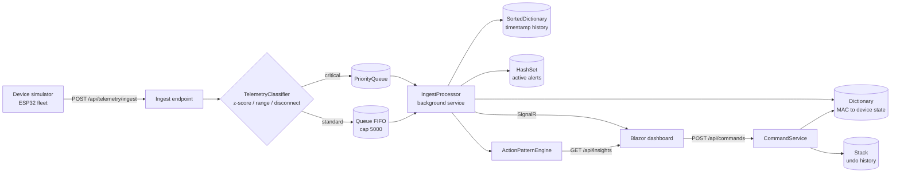

# Smart-X IoT Mesh Ecosystem

**PROG7312 Portfolio of Evidence: Part 1 (Sensor Data Ingestion and Telemetry) and Part 2 (Real-Time Command Stream and Device Management)**

Built on **.NET 10**: an ASP.NET Core Minimal API with SignalR, a Blazor WebAssembly dashboard, a device simulator that behaves like a fleet of ESP32 nodes, and an xUnit test project.

| | |
|---|---|
| Repository | `https://github.com/VanNiekerkJoe/PROG7312st10445055part1` |
| Demo video (Part 2) | `[PASTE YOUTUBE LINK HERE]` |
| Stack | .NET 10, ASP.NET Core Minimal API, SignalR, Blazor WebAssembly, xUnit, Docker Compose |

---

## Table of contents

1. [Scenario and IoT research](#1-scenario-and-iot-research)
2. [Solution layout](#2-solution-layout)
3. [Architecture](#3-architecture)
4. [Prerequisites, build and run](#4-prerequisites-build-and-run)
5. [Part 2 feature tour](#5-part-2-feature-tour)
6. [Data structures: what, where and why](#6-data-structures-what-where-and-why)
7. [How to test the queue and dictionary implementations](#7-how-to-test-the-queue-and-dictionary-implementations)
8. [Predictive Action and Recommendation Engine](#8-predictive-action-and-recommendation-engine)
9. [Navigation, state and SignalR resilience](#9-navigation-state-and-signalr-resilience)
10. [API reference](#10-api-reference)
11. [Automated tests](#11-automated-tests)
12. [Docker](#12-docker)
13. [Design trade-offs and known limitations](#13-design-trade-offs-and-known-limitations)
14. [Part 1 notes](#14-part-1-notes)
15. [Rubric mapping](#15-rubric-mapping)

---

## 1. Scenario and IoT research

Smart-X is a hybrid IoT ecosystem for monitoring distributed environments such as hydroponic farms, automated utility trackers and smart grid installations. Thousands of microcontrollers (ESP32-class chips) publish constant, multi-typed telemetry (floats for soil moisture, integers for power wattage, booleans for valve states) to a central gateway. The environment here is a **simulation**: the `SmartX.DeviceSimulator` project posts to the API over HTTP exactly as a physical device would.

The design is driven by how real IoT back ends behave, not by a generic CRUD application:

| IoT concern | What it means in practice | How Smart-X handles it |
|---|---|---|
| **Bursty, high-volume telemetry** | Hundreds of nodes can report at once, and a reconnecting fleet floods the gateway with buffered readings. | A bounded ingest buffer sits between the HTTP endpoint and the processor. The endpoint only classifies and enqueues, so it returns immediately and a spike never blocks the API. |
| **Back-pressure** | A gateway has finite memory. Accepting everything eventually crashes it. | The standard lane has a hard cap (`MaxStandardDepth = 5000`). When it is full, `Enqueue` returns `false` and the API tells the device to retry later. |
| **Not all readings are equal** | A routine moisture reading can wait. A power spike or a critical moisture drop in a hydroponics node cannot. | **Two-lane ingestion**: critical packets go to a `PriorityQueue` that is always drained first, so they bypass any backlog. |
| **Anomaly detection at the edge of the pipeline** | Alerts must be raised on arrival, not discovered later. | `TelemetryClassifier` flags a packet as critical at ingest time using a rolling per-device baseline (z-score of 3 or more), an out-of-range value, or a device-reported disconnect. |
| **Device liveness (heartbeat / last-will)** | A dead node sends nothing, so absence of data is the signal. MQTT solves this with keep-alive and last-will messages. | HTTP has no last-will, so `IngestProcessor` sweeps every 5 s and marks any device silent for more than 20 s as *Disconnected*. |
| **Alert storms** | A node that stays offline would raise the same alert on every sweep and bury operators in duplicates (alert fatigue). | A `HashSet<T>` of active alerts refuses duplicates, and the dashboard shows how many were suppressed. |
| **Device identity** | Devices identify themselves by hardware address, not by a friendly name. | The device registry is a `Dictionary` keyed by **MAC address**, so every packet resolves its sender in O(1). |
| **Safe actuation** | Commands change physical state (pumps, valves, relays). Operators make mistakes. | Every command has an exact inverse and is recorded on a `Stack<T>`, giving a one-click undo. |
| **Protocol choice** | MQTT (publish/subscribe, QoS levels, retained messages) is the usual transport on constrained hardware. | Ingestion is HTTP so the simulator, the browser demo and the tests share one front door. The queue, classifier and device store are transport-agnostic, so an MQTT subscriber could feed `TelemetryIngestQueue` without changing anything downstream. |

Live and simulated data are interchangeable: any real device that can `POST /api/telemetry/ingest` with its MAC address and a value can be registered and will appear in the dashboard.

---

## 2. Solution layout

```
SmartX.sln
 SmartX.Core            Domain and data structures (no ASP.NET dependency)
   Ingestion/             TelemetryIngestQueue  (Queue<T> + PriorityQueue)
   Commands/              CommandHistory        (Stack<T> undo + capped audit log)
   Storage/               DeviceStateStore      (Dictionary by MAC)
                          SortedHistoryLog      (SortedDictionary by timestamp)
                          ActiveAlertSet        (HashSet<T>)
   Insights/              ActionPatternEngine   (learned suggestions with recency decay)
   Telemetry/ Devices/ Batching/   Part 1 domain model
 SmartX.Api             Minimal API, SignalR hubs, IngestProcessor background service
 SmartX.Client          Blazor WebAssembly dashboard (Part 1 + Part 2 pages)
 SmartX.DeviceSimulator Console app that acts like a fleet of ESP32 nodes
 SmartX.Api.Tests       xUnit tests for Core and the engine
 docker-compose.yml     API + client + simulator
```

Keeping the data structures in `SmartX.Core` means they are unit-testable in isolation, with no web host.

---

## 3. Architecture



**Processing loop.** Every 100 ms `IngestProcessor` handles a bounded batch of up to 50 packets (about 500 packets per second), which models a resource-constrained gateway. Critical packets are always dequeued first. Within a tick, only the latest status per device is broadcast, so a burst of hundreds of packets for one device becomes one SignalR message.

---

## 4. Prerequisites, build and run

### Prerequisites

- **.NET 10 SDK** (`dotnet --version` should report `10.0.1xx`). If your SDK reports a different minor version, bump the three `PackageReference` versions in `SmartX.Client/SmartX.Client.csproj` to match.
- **`wasm-tools` workload** for the Blazor WebAssembly client. Install once, from an elevated terminal:
  ```
  dotnet workload install wasm-tools
  ```
  Without it, building the client fails with `NETSDK1112`.
- **Visual Studio 2026 (18.0+)** if you use Visual Studio. Visual Studio 2022 cannot open `net10.0` projects. The `dotnet` CLI works regardless.
- A modern browser.

### Build

From the solution root:

```
dotnet restore
dotnet build
```

### Run (three terminals)

```
# Terminal 1: API
cd SmartX.Api
dotnet run

# Terminal 2: Client
cd SmartX.Client
dotnet run

# Terminal 3: simulated devices
cd SmartX.DeviceSimulator
dotnet run                          # defaults to https://localhost:5001
# dotnet run -- http://localhost:5000   # or pass the API URL
```

Confirm the API's port from its console output. If it differs from `https://localhost:5001`, update `apiBaseAddress` in `SmartX.Client/Program.cs` and `Cors:ClientOrigin` in `SmartX.Api/appsettings.json`.

Open the URL the client prints (default `https://localhost:5173`).

**Simulator keys:** `S` spikes a random sensor, `X` silences a random device for 30 s, `Q` quits.

### Firebase authentication setup

The dashboard uses Firebase email/password authentication. The Firebase project ID and Web API key are included in `SmartX/SmartX.Api/appsettings.json` so a fresh clone can run without local user-secrets. The Web API key is an identifier used by client applications, not an account credential; restrict it in Google Cloud Console to the **Identity Toolkit API**. All sensor, telemetry, command, insight, and SignalR hub operations require a valid Firebase ID token.

In Firebase Console, enable the **Email/Password** sign-in provider. The sign-in screen can create an account or sign in an existing operator, so a marker can register an account. Provide a demo operator account's credentials in your submission notes, not in this repository. The API validates token signature, issuer, audience, and expiry against the configured project. The root health endpoint and `/api/auth/config` remain public; dashboard APIs and both hubs are protected.

The attachment encryption key in `appsettings.json` is a development key; replace it with a securely managed key for production. The device simulator also authenticates. Set `SMARTX_FIREBASE_EMAIL` and `SMARTX_FIREBASE_PASSWORD` in its process environment to a Firebase operator account before starting it. It obtains and refreshes its ID token automatically. Do not put account passwords in source files.

### Importing a device list

On **Sensor ingestion**, choose **Import .txt device list** and select a UTF-8 text file containing one tab-separated device per line:

```
subZoneId<TAB>MAC address<TAB>category<TAB>location description
```

For example, a row may contain `SUB-ZONE-1`, `24:6F:28:AA:BB:CC`, `Environmental`, and `North greenhouse`, separated by literal tab characters. The header row is optional. Categories are `Environmental`, `Power`, and `Actuator`. Files are limited to 1 MB and 500 device rows. Valid rows are registered independently, successful devices appear immediately in the constellation, and failed rows are reported with their line numbers.

---

## 5. Part 2 feature tour

### Main menu and navigation

A top navigation bar (`NavMenu`, hosted in `MainLayout`) appears on every page:

| Module | Status |
|---|---|
| Home | Pillar menu |
| Sensor ingestion | Part 1, fully working |
| **Command stream** | **Part 2, this submission** |
| Mesh topology | Disabled, planned for the final PoE |

Switching between modules is asynchronous and does not lose state or open duplicate connections (see [section 9](#9-navigation-state-and-signalr-resilience)).

### Real-Time Command Stream page

- **Pipeline tiles:** standard queue depth, priority lane depth, packets processed per second, active alerts, duplicate alerts blocked, and learned patterns, all updated live over SignalR.
- **Live stream:** newest-first feed of processed telemetry. Priority alerts appear as red rows and trigger a banner showing how many packets were still queued when the alert was handled.
- **Device list with search and filter:** free-text search across device ID, zone, category and state, plus category and state dropdowns, with a live `matches / total` counter.
- **Manual overrides:** Pump ON/OFF, Relay ON/OFF, Valve OPEN/CLOSE against the selected device.
- **Undo last command:** pops the stack and issues the inverse command.
- **Timeline graph:** the selected device's recent readings, read straight from the sorted history structure, with amber/red dots for non-healthy readings.
- **Suggested actions / Automated insights:** ranked recommendations with a confidence bar and an **Apply** button.
- **Demo controls:** *Flood queue (2000 packets)*, *Fire priority alert on selected*, *Train demo patterns*.

---

## 6. Data structures: what, where and why

| Structure | File | Used for | Complexity | Why this structure |
|---|---|---|---|---|
| `Queue<T>` | `Ingestion/TelemetryIngestQueue.cs` | Standard telemetry in strict arrival order | Enqueue / dequeue O(1) | FIFO is exactly the required semantics, and it is bounded for back-pressure. |
| `PriorityQueue<TElement,TPriority>` | `Ingestion/TelemetryIngestQueue.cs` | Critical alerts that bypass the backlog | Enqueue / dequeue O(log n) | Higher urgency is served first. Priority is `(-urgency, sequence)`, so equal urgency stays first-come-first-served (`PriorityQueue` alone is not stable). |
| `Stack<T>` | `Commands/CommandHistory.cs` | Undo history of manual overrides | Push / pop O(1) | LIFO matches undo: the last command issued is the first reverted. Capped (see below). |
| `Queue<T>` (capped) | `Commands/CommandHistory.cs` | Audit log shown in the history panel | Append and trim oldest O(1) | Trimming the oldest entry from a `List<T>` with `RemoveAt(0)` is O(n). A queue drops its head in O(1). |
| `Dictionary<TKey,TValue>` | `Storage/DeviceStateStore.cs` | Registered devices keyed by **MAC address**, plus device ID to MAC | Lookup O(1) average | Every packet must resolve its sender instantly. Scanning the deployment tree would be O(n) per packet. |
| `SortedDictionary<TKey,TValue>` | `Storage/SortedHistoryLog.cs` | Per-device history keyed by timestamp | Insert / remove O(log n) | The tree stays ordered as data arrives, so the dashboard never sorts at query time. |
| `HashSet<T>` | `Storage/ActiveAlertSet.cs` | Active unique alert states (`deviceId|kind`) | Add / remove / contains O(1) | Sets store unique elements, so a second Disconnected alert for the same sensor is refused automatically. |
| Nested `Dictionary` | `Insights/ActionPatternEngine.cs` | Transition table `context -> follow-up -> weight` | O(1) update | A sparse table of learned (context, command) pairs. |

### Capacity and bounds

Every growing structure has a limit, because a long-running gateway cannot let any of them grow without bound:

| Structure | Bound | Behaviour at the limit |
|---|---|---|
| Standard ingest lane | 5000 packets | `Enqueue` returns `false` (back-pressure) |
| Undo stack | 200 commands | The oldest undo entry is discarded when a new command is pushed |
| Audit log | 200 entries | The oldest entry is dequeued |
| History per device | 300 points | The oldest timestamp is removed |

### The undo stack in detail

`Issue` pushes the command onto the stack and appends it to the audit log. `Undo` pops the most recent command and issues its **inverse** (`PumpOn` becomes `PumpOff`). The inverse command is recorded in the audit log and flagged `IsUndo`, but it is **not pushed onto the stack**. This means an undo cannot itself be undone: pressing Undo repeatedly walks backwards through the operator's own commands (Relay OFF, then Pump ON, and so on) and returns nothing once the stack is empty. A unit test proves this.

### History timeline: complexity trade-off

`SortedDictionary` gives O(log n) insertion and keeps keys ordered, which is the right trade for a write-heavy telemetry stream. Reading the latest N points walks the tree and skips the older entries, so a read is **O(n)** in the number of stored points for that device. With the 300-point cap this is trivial (a few microseconds), and the cap is what keeps it cheap.

If the cap were raised substantially, two options exist: enumerate in reverse (`Reverse()` over the tree) and take N from the end, or switch to a `SortedList<TKey,TValue>`, which supports indexed access to the tail at the cost of O(n) inserts. Because telemetry arrives in timestamp order, inserts land at the end anyway, so `SortedList` would also be cheap here. `SortedDictionary` was kept because inserts are the hot path and the cap bounds the read cost.

---

## 7. How to test the queue and dictionary implementations

Start the API, client and simulator, then open **Command stream**.

### Test 1: Queue<T> (FIFO)

1. Click **Flood queue (2000 packets)**.
2. Watch the **Standard queue** tile climb to about 2000, then drain at roughly 500 packets per second.
3. Packets are processed in arrival order. `IngestQueueTests` asserts this at unit level.

### Test 2: simulate a high-priority alert (PriorityQueue)

1. Click **Flood queue (2000 packets)** to build a backlog in the standard lane.
2. Select any Environmental or Power sensor in the device list.
3. Click **Fire priority alert on selected**. A critical packet (3x the device's value) is posted to `/api/telemetry/simulate-alert` and enters the priority lane.
4. The alert appears **immediately** at the top of the Live stream as a red row and the **Priority lane** tile ticks up, even though thousands of standard packets are still queued. The banner reports how many packets were still waiting when it was processed.

Other ways to trigger one: press **S** in the simulator window, or POST a reading far outside the sensor's range to `/api/telemetry/ingest`:

```
curl -k -X POST https://localhost:5001/api/telemetry/ingest ^
  -H "Content-Type: application/json" ^
  -d "{\"macAddress\":\"<a registered MAC>\",\"value\":9999}"
```

### Test 3: Stack<T> (undo)

1. Select a device and click **Pump ON**, then **Relay OFF**.
2. Click **Undo last command**. **Relay ON** is issued first (LIFO).
3. Click **Undo** again. **Pump OFF** is issued.
4. Click **Undo** a third time. Nothing happens: the stack is empty, and the undo commands themselves were never pushed.

### Test 4: Dictionary (O(1) lookup)

1. Run the simulator. Each packet carries only a MAC address and a value.
2. The device state updates instantly without any search. The lookup is `DeviceStateStore.TryGetByMac` (`Dictionary`, case-insensitive MAC key).
3. Register a new device from **Sensor ingestion**. `DeviceStateStore.Sync` adds it to both dictionaries on the next sync tick, and packets for its MAC resolve at once.

### Test 5: SortedDictionary (timeline)

Select a device. The timeline graph is read from `GET /api/telemetry/history/{deviceId}?count=60`, already in timestamp order, with no sorting at query time.

### Test 6: HashSet (duplicate alert suppression)

1. Press **X** in the simulator to silence a device.
2. After about 20 s the device raises **one** Disconnected alert.
3. On every later sweep the **Duplicate alerts blocked** tile climbs instead of a new alert being raised.

### Test 7: search and filter

Type a term (for example `pump`) in the device search, choose a category or state filter, then navigate to Home and back. The search text, filters and selected device are still there.

---

## 8. Predictive Action and Recommendation Engine

`SmartX.Core/Insights/ActionPatternEngine.cs` learns from operator behaviour with a **first-order Markov-style transition table**:

```
context  --(recency-decayed weight)-->  follow-up command
```

A **context** is an alert (`alert:Power:Anomalous`) or an operator search (`search:pump a`). Whenever an operator issues a manual command within **90 seconds** of a context, the weight of that (context, follow-up) pair increases. The data structure is a nested `Dictionary`: `context -> follow-up -> (real weight, demo weight, timestamp)`.

### How learning stays honest

| Rule | Why it matters |
|---|---|
| **One command teaches each distinct context once.** If an operator searches "pump" three times and then issues one command, that is one observation, not three. | Without this, repeated searching would inflate a pattern. |
| **Commands taken from a suggestion are not learned from.** The *Apply* button sends `FromSuggestion = true`, and `CommandService` skips `ObserveCommand` for it. | Accepting a suggestion shows obedience, not independent behaviour. Learning from it would make the engine reinforce its own output. |
| **An alert only teaches about commands sent to the device that raised it.** | A command to one device says nothing about another. |
| **Suggestions only target devices that currently exist.** Search suggestions are checked against the live device list, and `RetainOnly` (called on the ingest sync tick, like the other stores) purges what was learned about removed devices. | Stops stale suggestions pointing at deleted devices. |
| **Search matching is by prefix, from 3 characters.** "pum" and "pump a" both find a learned "pump"; "ump" and "p" do not. | Loose substring matching let a short term match half the table. |

### Ranking and confidence

```
confidence(context, command) = weight / (total weight for the context + 1)
```

The "+ 1" is a prior (add-one smoothing). Two observations of the same command give a confidence of about 0.67, not 1.0, and confidence only approaches 1.0 as evidence accumulates. This also keeps learned suggestions on a sensible scale next to the cold-start rules (0.4 to 0.55).

A learned pattern needs **minimum support of 1.5** recency-weighted observations: two fresh observations, or three that are one half-life old. A single one-off never qualifies. Only the best follow-up and, if it has at least half the leader's weight, one runner-up are shown, so the panel does not offer "Relay ON" and "Relay OFF" side by side because of a single stray command.

Suggestion slots reserve room for the best matching search suggestion, watch-list or disconnect inspection, alert-learned action, and cold-start rule before filling remaining slots by the normal ranking. The selected suggestions are then sorted by confidence, learned before rule before watch-list, then device ID, so slot guarantees do not change the panel's top-to-bottom ranking.

### Recency decay

Operator habits change, so old behaviour counts for less. Every weight decays exponentially:

```
weight(now) = weight(then) * 0.5 ^ (age / half-life)
```

- **Learned patterns:** half-life of **7 days** (`ActionPatternOptions.PatternHalfLife`).
- **Watch-list alert counts:** half-life of **6 hours** (`WatchHalfLife`). A device is "misbehaving lately", not forever.

Decay is applied lazily when a pair is read or updated, so there is no background timer. The engine takes a `TimeProvider`, so the unit tests move a manual clock forward (two half-lives, 120 days) instead of waiting. Practical effects:

- Recent behaviour outranks old behaviour, so if the operator changes their routine, the suggestion changes with them.
- Evidence that has decayed below 0.05 is **deleted**, and the number of contexts is capped at 200 (weakest evicted first), so memory stays bounded.
- Confidence is a recency-weighted relative frequency, not a raw count.

All tunables (`FollowWindow`, half-lives, `MinSupport`, `PriorWeight`, `WatchThreshold`, `PruneBelow`, caps) live in the `ActionPatternOptions` record.

### Suggestion sources

| Source | Trigger | Shown as |
|---|---|---|
| **Learned (alert)** | An alert context has a pair above the support threshold | "Recency-weighted operator evidence for Relay OFF is 2.9 of 3.0 effective observations after similar Power Anomalous alerts" |
| **Learned (search)** | The operator is searching a term that previously preceded commands | "This command followed the search 'pump' with 3.0 of 3.0 recency-weighted effective observations" |
| **Cold-start rules** | An anomalous device has no learned alert pattern yet (for example anomalous Power suggests Relay OFF) | Rule-based suggestion |
| **Disconnect inspection** | A device is disconnected and has stopped reporting | "Inspect <device>: no data for <duration>" (no remote command is recommended because the device may not be able to receive it) |
| **Watch-list** | A device's recency-weighted alert count reaches 2.5 (about three alerts in a few hours) | "Inspect <device>" (no command is applied automatically) |

Suggestions appear in the **Suggested actions / Automated insights** panel before the operator searches for them, with a confidence bar and an **Apply** button. Wording is deliberately cautious: learned responses are presented as workflow preferences, not diagnoses, and tell the operator to confirm the device's state first.

### Cold start and demo data (stated openly)

A learning system has nothing to suggest on first launch, and the engine's state is held **in memory**, so it resets when the API restarts. Two cold-start mechanisms cover this:

1. **Rules** (above), which cover problem devices with no history.
2. **Demo patterns:** the **Train demo patterns** button calls `SeedDemoPatterns`, which pre-loads an *illustrative* operator history so the learned path can be demonstrated without waiting for real behaviour.

Seeded patterns are **demonstration data, not real operator history**, and the engine treats them that way:

- Demo weight is stored **separately** from real weight, and any suggestion that relies on it says so in its text ("This pattern comes from seeded demo data, not real operator history", or "Part of this evidence is seeded demo data" once real observations have been added on top).
- Seeding is **idempotent**: it sets the demo values instead of adding to them, so pressing the button repeatedly changes nothing.
- Demo data decays and is pruned like everything else.

To see genuinely learned behaviour without seeding: trigger an alert on a device, issue the same command within 90 s, and repeat; after minimum support is met the suggestion appears. Persisting the table to disk or a database is out of scope for this part and is listed under limitations.

---

## 9. Navigation, state and SignalR resilience

- `NavMenu` is rendered by `MainLayout`, so it is present on every page and the active module is highlighted.
- `LiveStateService` is an **app-lifetime singleton**. It owns the SignalR subscriptions, device statuses, command history, the live feed, and the operator's **search text, category filter, state filter and selected device**. Pages read from it instead of keeping their own copies.
- Navigating Home, Sensor ingestion and Command stream disposes the page component but not the service, so **nothing is lost and no second hub connection is opened**.
- Change notifications are coalesced to at most one every 250 ms, so a burst of thousands of packets cannot freeze the browser or the render thread.
- **Reconnection:** both `TelemetryHubClient` and `CommandHubClient` use `WithAutomaticReconnect()`. When a connection drops (for example the API restarts), the topbar shows **offline**, SignalR retries automatically, and on `Reconnected` the client re-fetches the full device list, command log and stats from the API so it cannot drift out of sync. No page refresh is needed.

To verify: set a search term and a filter, navigate to Home and back (they persist), then stop and restart the API while the dashboard is open (the indicator goes offline, then returns to live and data resumes).

---

## 10. API reference

### Part 2

| Method | Route | Purpose |
|---|---|---|
| POST | `/api/telemetry/ingest` | Device front door: `{ macAddress, value, disconnected? }` |
| POST | `/api/telemetry/simulate-alert` | Demo: forced critical packet for `{ deviceId }` |
| POST | `/api/telemetry/burst?count=2000` | Demo: flood the standard lane |
| GET | `/api/telemetry/stats` | Queue depths, processed counts, alert counts |
| GET | `/api/telemetry/history/{deviceId}?count=60` | Timeline points, timestamp-sorted |
| GET / POST | `/api/commands` | Command log and undo depth / issue `{ deviceId, type }` |
| POST | `/api/commands/undo` | Pop the stack and send the inverse command |
| GET | `/api/insights?search=` | Suggested actions |
| POST | `/api/insights/search` | Log an operator search so the engine can learn from it |
| POST | `/api/insights/train-demo` | Preload demonstration patterns |

### SignalR

| Hub | Path | Events |
|---|---|---|
| `CommandHub` | `/hubs/commands` | `CommandIssued`, `CommandUndone`, `PriorityAlert`, `PipelineStats` |
| `TelemetryHub` | `/hubs/telemetry` | `DeviceStatusUpdated`, `DeviceRemoved`, `AllDevicesCleared` |

### Part 1

| Method | Route | Purpose |
|---|---|---|
| GET | `/api/sensors` | Latest status for every known device |
| GET | `/api/sensors/tree` | Facility, Zone, Sub-Zone, Device tree |
| GET | `/api/sensors/validate` | Re-run the recursive tree validator |
| POST | `/api/sensors/register` | Register a device under a sub-zone |
| DELETE | `/api/sensors/{deviceId}` | Remove one device and all its indexes |
| POST | `/api/sensors/clear` | Remove every device, keep the skeleton |
| POST | `/api/sensors/{deviceId}/attachments` | Upload a config file, photo or log |
| GET / POST | `/api/sensors/seeder/status`, `/start`, `/stop` | Dev controls for the generator |

---

## 11. Automated tests

```
dotnet test SmartX.Api.Tests
```

| Area | What is verified |
|---|---|
| `IngestQueueTests` | FIFO order, priority bypass, equal-urgency tie-breaking, back-pressure at the cap |
| `CommandHistoryTests` | LIFO undo order, empty-stack undo returns nothing, **undoing an undo is not possible** (inverse commands are never pushed), undo stack cap evicts the oldest entry, audit log cap |
| `SensorRegistryTests` / `PipelineStructuresTests` | MAC lookup and sync, duplicate-alert suppression, sorted history ordering and capacity |
| `ActionPatternEngineTests` | Learned, rule-based and watch-list paths; minimum support; smoothed confidence; **decay on an injected clock** (evidence halves, then is pruned); watch-list fades; repeated searches credited once; weak runner-up hidden; demo data labelled and idempotent; removed devices purged; prefix-only search matching; stable ordering |
| `CoreDomainTests`, `DeploymentTreeValidatorTests` | Part 1: operator overloads, jagged-array batching, recursive tree validation |

---

## 12. Docker

```
docker compose up --build
```

Starts the API (`8080`), the client (`8081`) and the simulator. The simulator reaches the API through `SMARTX_API_URL=http://smartx-api:8080`.

**Known limitation:** the Blazor client reads its API base address from a compile-time constant in `Program.cs`, which suits local `dotnet run`. In Docker the browser must be able to reach the API on the published port, so run the stack with the API address that matches your host, or move `apiBaseAddress` into `wwwroot/appsettings.json`. For marking, the three-terminal local run in [section 4](#4-prerequisites-build-and-run) is the reference way to run the full system.

---

## 13. Design trade-offs and known limitations

- **In-memory state.** Registry, history, alerts and learned patterns reset on API restart. A production gateway would persist them. The data structures sit behind small classes so a store could be swapped in.
- **Single-process, lock-based.** Each structure guards itself with a lock. That is correct and simple for one API instance. Scaling out would need a shared queue (for example a message broker) instead of in-process collections.
- **HTTP ingestion.** MQTT would be more natural on real hardware ([section 1](#1-scenario-and-iot-research)). The pipeline after the endpoint does not depend on the transport.
- **Rolling baseline.** The z-score classifier needs a few samples before it is meaningful, so the first packets from a new device are judged by range only.
- **History reads are O(n)** in the capped history size ([section 6](#history-timeline-complexity-trade-off)).
- **Suggestions are advisory.** The engine never applies a command on its own. Every learned suggestion needs an operator click.

Out of scope until the final PoE: **Network Topology and Mesh Routing**.

---

## 14. Part 1 notes

Part 1 delivered Sensor Data Ingestion and Telemetry.

- **Generics without boxing:** `TelemetryPacket<T> where T : struct`, closed over `float`, `int` and `bool`.
- **Operator overloading:** `SensorReading` overloads `+`, `-`, `>`, `<`, `>=`, `<=`, `==`, `!=` for aggregation and threshold comparison.
- **Jagged arrays to `List<T>`:** `TelemetryBatcher<T>` buffers windows into a `T[][]`, then flushes to a flat list.
- **Recursion:** `DeploymentTreeValidator` walks the Facility, Zone, Sub-Zone, Device tree, checking MAC uniqueness and that every ancestor is configured.
- **Anomaly Constellation:** a live radial view of every sensor with a detail panel and file attachment.
- **Server-authoritative clear:** `SensorRegistry.ClearAllDevices()` and `RemoveDevice(id)` purge every index, the seeder re-reads the device list each tick, and the client re-syncs on SignalR reconnect, so multiple dashboards cannot drift apart.

---

## 15. Rubric mapping

| Rubric area (marks) | Where to look |
|---|---|
| Main menu, navigation and state (30) | `NavMenu`, `MainLayout`, `LiveStateService`; [section 9](#9-navigation-state-and-signalr-resilience); Part 1 pages still work alongside Part 2 |
| Stacks and queues (15) | `TelemetryIngestQueue`, `CommandHistory`; [section 7](#7-how-to-test-the-queue-and-dictionary-implementations) tests 1 to 3 |
| Dictionaries and key-value maps (15) | `DeviceStateStore` (MAC, O(1)), `SortedHistoryLog` (timestamp order); tests 4 and 5 |
| Sets (10) | `ActiveAlertSet`; test 6 |
| Predictive action and suggestion engine (30) | `ActionPatternEngine`; [section 8](#8-predictive-action-and-recommendation-engine) |
| GitHub, commits, collaboration, README | This repository and this README |
