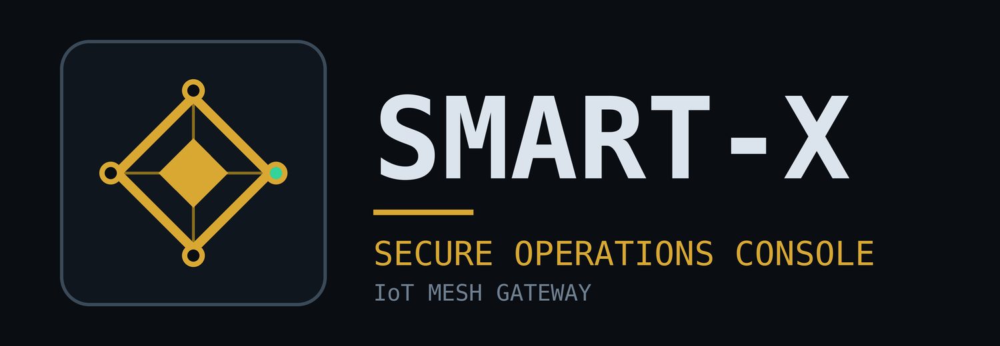
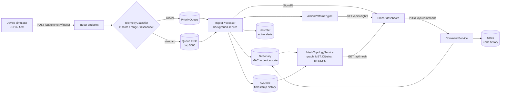

# Smart-X IoT Mesh Ecosystem

<p align="center"></p>

A hybrid IoT monitoring platform for distributed environments (hydroponic farms, utility trackers, smart grids). A fleet of ESP32-style sensors reports telemetry to a gateway; operators watch, command and route around failures from a live dashboard.

**PROG7312 Portfolio of Evidence** &middot; Part 1: Sensor Data Ingestion and Telemetry &middot; Part 2: Real-Time Command Stream and Device Management &middot; Part 3: Network Topology and Mesh Routing

| | |
|---|---|
| Repository | https://github.com/VanNiekerkJoe/PROG7312st10445055part1 |
| Demo video (Part 3) | `[PASTE YOUTUBE LINK HERE]` |
| Stack | .NET 10, ASP.NET Core Minimal API, SignalR, Blazor WebAssembly, Firebase Authentication, xUnit, Docker Compose |
| Author | Joe Leo van Niekerk (ST10445055) |

<!-- Screenshots: add images under docs/images and link them here, for example  -->

## Table of contents

1. [Overview](#1-overview)
2. [Quick start](#2-quick-start)
3. [Configuration](#3-configuration)
4. [Using the application](#4-using-the-application)
5. [Architecture and solution layout](#5-architecture-and-solution-layout)
6. [Data structures: what, where and why](#6-data-structures-what-where-and-why)
7. [Part 3 in depth: mesh topology and routing](#7-part-3-in-depth-mesh-topology-and-routing)
8. [Part 2 in depth: command stream](#8-part-2-in-depth-command-stream)
9. [Part 1 notes](#9-part-1-notes)
10. [API reference](#10-api-reference)
11. [Automated tests](#11-automated-tests)
12. [Docker](#12-docker)
13. [Troubleshooting](#13-troubleshooting)
14. [Design trade-offs and known limitations](#14-design-trade-offs-and-known-limitations)
15. [Rubric mapping](#15-rubric-mapping)
16. [Project documents](#16-project-documents)

---

## 1. Overview

Smart-X is a hybrid IoT ecosystem for monitoring distributed environments such as hydroponic farms, automated utility trackers and smart grid installations. Thousands of microcontrollers (ESP32-class chips) publish constant, multi-typed telemetry (floats for soil moisture, integers for power wattage, booleans for valve states) to a central gateway. The environment here is a **simulation**: the `SmartX.DeviceSimulator` project posts to the API over HTTP exactly as a physical device would.

### What each part delivers

| Part | Page | What it does | Key data structures |
|---|---|---|---|
| **1. Ingestion and telemetry** | Sensor ingestion | Device registration (single or imported list), recursive validation of the Facility / Zone / Sub-Zone / Device tree, a live "Anomaly Constellation" of every sensor, encrypted file attachments | Generics, jagged arrays, recursion, operator overloading |
| **2. Real-time commands** | Command stream | Two-lane ingest pipeline with back-pressure, heartbeat sweep, manual overrides with undo, audit log, search and filter, predictive action suggestions | `Queue`, `PriorityQueue`, `Stack`, `Dictionary`, `HashSet` |
| **3. Network topology** | Mesh topology | Live mesh map, route tracking by MAC, self-healing around failed nodes, BFS and DFS reachability, minimum spanning tree, historical range queries | AVL tree, min-heap, graph (adjacency list), Prim, Kruskal, Dijkstra, union-find |

### Why the design looks the way it does

The design is driven by how real IoT back ends behave, not by a generic CRUD application:

| IoT concern | What it means in practice | How Smart-X handles it |
|---|---|---|
| **Bursty, high-volume telemetry** | Hundreds of nodes can report at once, and a reconnecting fleet floods the gateway with buffered readings. | A bounded ingest buffer sits between the HTTP endpoint and the processor. The endpoint only classifies and enqueues, so it returns immediately and a spike never blocks the API. |
| **Back-pressure** | A gateway has finite memory. Accepting everything eventually crashes it. | The standard lane has a hard cap (`MaxStandardDepth = 5000`). When it is full, `Enqueue` returns `false` and the API tells the device to retry later. |
| **Not all readings are equal** | A routine moisture reading can wait. A power spike or a critical moisture drop in a hydroponics node cannot. | **Two-lane ingestion**: critical packets go to a `PriorityQueue` that is always drained first, so they bypass any backlog. |
| **Anomaly detection at the edge of the pipeline** | Alerts must be raised on arrival, not discovered later. | `TelemetryClassifier` flags a packet as critical at ingest time using a rolling per-device baseline (z-score of 3 or more), an out-of-range value, or a device-reported disconnect. |
| **Device liveness (heartbeat / last-will)** | A dead node sends nothing, so absence of data is the signal. MQTT solves this with keep-alive and last-will messages. | HTTP has no last-will, so `IngestProcessor` sweeps every 5 s and marks any device silent for more than 20 s as *Disconnected*. |
| **Alert storms** | A node that stays offline would raise the same alert on every sweep and bury operators in duplicates (alert fatigue). | A `HashSet<T>` of active alerts refuses duplicates, and the dashboard shows how many were suppressed. |
| **Device identity** | Devices identify themselves by hardware address, not by a friendly name. | The device registry is a `Dictionary` keyed by **MAC address**, so every packet resolves its sender in O(1). |
| **Safe actuation** | Commands change physical state (pumps, valves, relays). Operators make mistakes. | Every command has an exact inverse and is recorded on a `Stack<T>`, giving a one-click undo. |
| **Protocol choice** | MQTT (publish/subscribe, QoS levels, retained messages) is the usual transport on constrained hardware. | Ingestion is HTTP so the simulator, the browser demo and the tests share one front door. The queue, classifier and device store are transport-agnostic, so an MQTT subscriber could feed `TelemetryIngestQueue` without changing anything downstream. |

Live and simulated data are interchangeable: any real device that can `POST /api/telemetry/ingest` with its MAC address and a value can be registered and will appear in the dashboard.

---

## 2. Quick start

### Prerequisites

- **.NET 10 SDK** (`dotnet --version` should report `10.0.1xx` or later). If your SDK reports a different minor version, bump the three `PackageReference` versions in `SmartX.Client/SmartX.Client.csproj` to match.
- **`wasm-tools` workload** for the Blazor WebAssembly client. Install once, from an elevated terminal:
  ```
  dotnet workload install wasm-tools
  ```
  Without it, building the client fails with `NETSDK1112`.
- **Visual Studio 2026 (18.0+)** if you use Visual Studio. Visual Studio 2022 cannot open `net10.0` projects. The `dotnet` CLI works regardless.
- A modern browser.
- A **Firebase operator account** (email and password) for sign-in; see [Configuration](#3-configuration).

### Build

```
git clone https://github.com/VanNiekerkJoe/PROG7312st10445055part1.git
cd PROG7312st10445055part1/SmartX
dotnet restore
dotnet build
```

All commands below run from the `SmartX` folder (the one that contains `SmartX.sln`).

### Run (three terminals)

```
# Terminal 1: API
cd SmartX.Api
dotnet run

# Terminal 2: Client
cd SmartX.Client
dotnet run

# Terminal 3: simulated devices (needs a Firebase operator account)
cd SmartX.DeviceSimulator
$env:SMARTX_FIREBASE_EMAIL = "operator@example.com"      # PowerShell
$env:SMARTX_FIREBASE_PASSWORD = "<your password>"
dotnet run                                               # defaults to https://localhost:5001
# dotnet run -- http://localhost:5000                    # or pass the API URL
```

Then open **https://localhost:5173**, create an account or sign in, and use the top navigation bar to move between **Sensor ingestion**, **Command stream** and **Mesh topology**.

**Simulator keys:** `S` spikes a random sensor, `X` silences a random device for 30 s, `Q` quits.

Confirm the API's port from its console output. If it differs from `https://localhost:5001`, update `apiBaseAddress` in `SmartX.Client/Program.cs` and `Cors:ClientOrigin` in `SmartX.Api/appsettings.json`.

---

## 3. Configuration

### Browser address and certificate

Open the client at **https://localhost:5173**. The plain-HTTP address (`http://localhost:5172`) is also allowed by the API's CORS policy (`Cors:AdditionalOrigins`), so either works, but any other origin is blocked by the browser. If the browser warns about the certificate, or sign-in says it could not contact Firebase authentication, trust the .NET development certificate once and restart the browser and the API:

```
dotnet dev-certs https --trust
```

The dashboard uses Firebase email/password authentication. The Firebase project ID and Web API key are included in `SmartX/SmartX.Api/appsettings.json` so a fresh clone can run without local user-secrets. The Web API key is an identifier used by client applications, not an account credential; restrict it in Google Cloud Console to the **Identity Toolkit API** and the **Token Service API** (the second one refreshes sign-in sessions). All sensor, telemetry, command, insight, and SignalR hub operations require a valid Firebase ID token.

In Firebase Console, enable the **Email/Password** sign-in provider. The sign-in screen can create an account or sign in an existing operator, so a marker can register an account. Provide a demo operator account's credentials in your submission notes, not in this repository. The API validates token signature, issuer, audience, and expiry against the configured project. The root health endpoint and `/api/auth/config` remain public; dashboard APIs and both hubs are protected.

The attachment encryption key in `appsettings.json` is a development key; replace it with a securely managed key for production. The device simulator also authenticates. Set `SMARTX_FIREBASE_EMAIL` and `SMARTX_FIREBASE_PASSWORD` in its process environment to a Firebase operator account before starting it. It obtains and refreshes its ID token automatically. Do not put account passwords in source files.

On **Sensor ingestion**, choose **Import .txt device list** and select a UTF-8 text file containing one tab-separated device per line:

```
subZoneId<TAB>MAC address<TAB>category<TAB>location description
```

For example, a row may contain `SUB-ZONE-1`, `24:6F:28:AA:BB:CC`, `Environmental`, and `North greenhouse`, separated by literal tab characters. The header row is optional. Categories are `Environmental`, `Power`, and `Actuator`. Files are limited to 1 MB and 500 device rows. Valid rows are registered independently, successful devices appear immediately in the constellation, and failed rows are reported with their line numbers.

---

## 4. Using the application

A top navigation bar (`NavMenu`, hosted in `MainLayout`) appears on every page. Switching between modules is asynchronous and does not lose state or open duplicate connections (see [Navigation, state and SignalR resilience](#84-navigation-state-and-signalr-resilience)).

| Module | Part | Purpose |
|---|---|---|
| Home | all | Pillar menu |
| Sensor ingestion | 1 | Register devices, the sensor constellation, attachments |
| Command stream | 2 | Live pipeline, overrides, undo, suggestions |
| Mesh topology | 3 | Mesh map, routing, reachability, historical queries |

### 4.1 Sensor ingestion (Part 1)

Register devices under a sub-zone one at a time or by importing a text list, watch every sensor in the live constellation, and attach config files, photos or logs to a device. See [Part 1 notes](#9-part-1-notes).

### 4.2 Command stream (Part 2)

- **Pipeline tiles:** standard queue depth, priority lane depth, packets processed per second, active alerts, duplicate alerts blocked, and learned patterns, all updated live over SignalR.
- **Live stream:** newest-first feed of processed telemetry. Priority alerts appear as red rows and trigger a banner showing how many packets were still queued when the alert was handled.
- **Device list with search and filter:** free-text search across device ID, zone, category and state, plus category and state dropdowns, with a live `matches / total` counter.
- **Manual overrides:** Pump ON/OFF, Relay ON/OFF, Valve OPEN/CLOSE against the selected device.
- **Undo last command:** pops the stack and issues the inverse command.
- **Timeline graph:** the selected device's recent readings, read straight from the sorted history structure, with amber/red dots for non-healthy readings.
- **Suggested actions / Automated insights:** ranked recommendations with a confidence bar and an **Apply** button.
- **Demo controls:** *Flood queue (2000 packets)*, *Fire priority alert on selected*, *Train demo patterns*.

Step-by-step checks for every data structure are in [How to test the queue and dictionary implementations](#82-how-to-test-the-queue-and-dictionary-implementations).

### 4.3 Part 3: mesh topology and routing

| Panel | What it does | Data structure behind it |
|---|---|---|
| **Live mesh** | Draws the gateway and every sensor with their wireless links. Thick green links are the minimum spanning tree. Down nodes turn red and their links dim. Click a node to track it. Refreshes every 3 seconds. | Graph, Prim's algorithm |
| **Route tracker** | Type a MAC address or device ID. Shows the route to the gateway as a hop-by-hop cost table, and (after a failure) the old route struck through next to the new one. When the node's own cheapest path costs less than its spanning-tree route, that path is listed and can be drawn on the map as a dotted blue line. **Fail node** and **Restore** simulate outages. | Graph, MST parent chain, Dijkstra |
| **Reachability** | Pick the whole network or one subnet (sub-zone) and BFS or DFS. Lists connected, down and stranded devices, and for every affected device the new path ("where to hop"). | BFS, DFS |
| **Telemetry history** | Pick a sensor and a UTC time window. Returns the readings, min / average / max, a chart, and how many tree nodes the query visited out of how many are stored. **Backfill demo data** adds 1,500 timestamped readings over six hours. | AVL tree |

#### Demo script

1. Start the API, client and simulator ([Quick start](#2-quick-start)), sign in, and open **Mesh topology**.
2. **Graph and MST:** the map shows the gateway and every sensor. Thick green links are the minimum spanning tree; the **MST power cost** card shows its total.
3. **Track by MAC:** paste a MAC address from the Sensor ingestion page (or click a node). The route to the gateway is highlighted in amber.
4. **Self-healing:** click the first relay in that route on the map (the node next to the gateway) and press **Fail node**. Then click the original node again: its route redraws around the failure, the old route appears struck through, and **Nodes online** has dropped by one.
5. **Traversal:** choose a subnet and **BFS** or **DFS**, then **Who is connected?** The panel lists connected, down and stranded devices and the new hops.
6. **Restore:** **Restore all nodes** returns the mesh to its original shape.
7. **AVL range query:** in Telemetry history, enter a device ID or MAC, click **Backfill demo data**, choose **Last 3 h** and **Run query**. Read the "tree visited N of M readings" line.

---

## 5. Architecture and solution layout



**Processing loop.** Every 100 ms `IngestProcessor` handles a bounded batch of up to 50 packets (about 500 packets per second), which models a resource-constrained gateway. Critical packets are always dequeued first. Within a tick, only the latest status per device is broadcast, so a burst of hundreds of packets for one device becomes one SignalR message.

**Mesh layer.** `MeshTopologyService` builds the graph from the same deployment tree the registry holds, so a device registered or removed in Part 1 appears in or leaves the mesh automatically. See [Part 3 in depth](#7-part-3-in-depth-mesh-topology-and-routing).

### Solution layout

```
SmartX.sln
 SmartX.Core            Domain and data structures (no ASP.NET dependency)
   Ingestion/             TelemetryIngestQueue  (Queue<T> + PriorityQueue)
   Commands/              CommandHistory        (Stack<T> undo + capped audit log)
   Storage/               DeviceStateStore      (Dictionary by MAC)
                          AvlTree               (self-balancing tree, range queries)
                          SortedHistoryLog      (per-device AvlTree by timestamp)
                          ActiveAlertSet        (HashSet<T>)
   Collections/           MinHeap               (binary heap for Prim and Dijkstra)
   Mesh/                  MeshGraph             (adjacency list, BFS, DFS, Prim, Kruskal, Dijkstra)
                          MeshTopologyBuilder   (deployment tree to mesh links)
                          MeshModels            (DTOs shared with the client)
   Insights/              ActionPatternEngine   (learned suggestions with recency decay)
   Telemetry/ Devices/ Batching/   Part 1 domain model
 SmartX.Api             Minimal API, SignalR hubs, IngestProcessor, MeshTopologyService
 SmartX.Client          Blazor WebAssembly dashboard (Parts 1, 2 and 3)
 SmartX.DeviceSimulator Console app that acts like a fleet of ESP32 nodes
 SmartX.Api.Tests       xUnit tests for Core, the engine and the mesh
 docker-compose.yml     API + client + simulator
docs/                   Completion report, technology recommendations, update ledger
```

Keeping the data structures in `SmartX.Core` means they are unit-testable in isolation, with no web host.

---

## 6. Data structures: what, where and why

| Structure | File | Used for | Complexity | Why this structure |
|---|---|---|---|---|
| `Queue<T>` | `Ingestion/TelemetryIngestQueue.cs` | Standard telemetry in strict arrival order | Enqueue / dequeue O(1) | FIFO is exactly the required semantics, and it is bounded for back-pressure. |
| `PriorityQueue<TElement,TPriority>` | `Ingestion/TelemetryIngestQueue.cs` | Critical alerts that bypass the backlog | Enqueue / dequeue O(log n) | Higher urgency is served first. Priority is `(-urgency, sequence)`, so equal urgency stays first-come-first-served (`PriorityQueue` alone is not stable). |
| `Stack<T>` | `Commands/CommandHistory.cs` | Undo history of manual overrides | Push / pop O(1) | LIFO matches undo: the last command issued is the first reverted. Capped (see below). |
| `Queue<T>` (capped) | `Commands/CommandHistory.cs` | Audit log shown in the history panel | Append and trim oldest O(1) | Trimming the oldest entry from a `List<T>` with `RemoveAt(0)` is O(n). A queue drops its head in O(1). |
| `Dictionary<TKey,TValue>` | `Storage/DeviceStateStore.cs` | Registered devices keyed by **MAC address**, plus device ID to MAC | Lookup O(1) average | Every packet must resolve its sender instantly. Scanning the deployment tree would be O(n) per packet. |
| `AvlTree<TKey,TValue>` (Part 3) | `Storage/AvlTree.cs`, `Storage/SortedHistoryLog.cs` | Per-device history keyed by timestamp, with range queries | Insert / remove / lookup O(log n), range O(log n + k) | A self-balancing tree stays ordered as data arrives, so the dashboard never sorts, and a time-window query touches only the matching part of the history. See [Part 3 in depth](#7-part-3-in-depth-mesh-topology-and-routing). |
| `HashSet<T>` | `Storage/ActiveAlertSet.cs` | Active unique alert states (`deviceId\|kind`) | Add / remove / contains O(1) | Sets store unique elements, so a second Disconnected alert for the same sensor is refused automatically. |
| Nested `Dictionary` | `Insights/ActionPatternEngine.cs` | Transition table `context -> follow-up -> weight` | O(1) update | A sparse table of learned (context, command) pairs. |
| `MinHeap<TElement,TPriority>` (Part 3) | `Collections/MinHeap.cs` | Candidate-edge queue for Prim's and Dijkstra's algorithms | Enqueue / dequeue O(log n) | Always yields the cheapest link next; hand-written so the sift-up and sift-down logic is ours to explain and test. |
| Adjacency list (Part 3) | `Mesh/MeshGraph.cs` | The mesh: node to its wireless links | O(V + E) space | A mesh is sparse (each node hears a few neighbours), so a list beats an O(V^2) matrix. |
| Union-find (Part 3) | `Mesh/MeshGraph.cs` | Cycle detection in Kruskal's algorithm | Near O(1) per operation | Path halving and union by size make "would this link close a loop?" almost free. |

### Capacity and bounds

Every growing structure has a limit, because a long-running gateway cannot let any of them grow without bound:

| Structure | Bound | Behaviour at the limit |
|---|---|---|
| Standard ingest lane | 5000 packets | `Enqueue` returns `false` (back-pressure) |
| Undo stack | 200 commands | The oldest undo entry is discarded when a new command is pushed |
| Audit log | 200 entries | The oldest entry is dequeued |
| History per device | 5000 points (was 300 in Part 2) | The oldest timestamp is removed (tree minimum) |

---

## 7. Part 3 in depth: mesh topology and routing

### 7.1 How the mesh is modelled

The simulation has no radio hardware, so links are generated from the deployment tree by `MeshTopologyBuilder`. The generation is deterministic (the same fleet always gives the same mesh and costs), which keeps demos and tests repeatable:

- every sub-zone is a ring of relays (each node hears its two neighbours);
- the first device in each sub-zone is that subnet's uplink to the **GATEWAY**;
- the last device of one sub-zone also hears the first device of the next, so subnets back each other up when an uplink dies;
- each link has a cost from 1 to 9 (relative transmit power), from a stable FNV-1a hash of the two endpoints.

A node is **down** when either the ingest pipeline has marked it *Disconnected* (no heartbeat for 20 s, the Part 2 sweep) or an operator has clicked **Fail node**. Devices registered, imported or deleted in Part 1 appear in or leave the mesh automatically, because the graph is rebuilt from the live deployment tree on each request.

### 7.2 Historical data querying: AVL tree

`Storage/AvlTree.cs` is a self-balancing binary search tree written from scratch. After every insert or delete it checks each node on the path back to the root and, if the left and right subtree heights differ by more than one, restores balance with a single or double rotation:

```csharp
private static Node Rebalance(Node node)
{
    Update(node);                       // height = 1 + max(child heights)
    var balance = BalanceOf(node);      // left height - right height

    if (balance > 1)                    // left-heavy
    {
        if (BalanceOf(node.Left!) < 0)
            node.Left = RotateLeft(node.Left!);    // left-right case
        return RotateRight(node);                   // left-left case
    }
    if (balance < -1)                   // right-heavy
    {
        if (BalanceOf(node.Right!) > 0)
            node.Right = RotateRight(node.Right!); // right-left case
        return RotateLeft(node);                    // right-right case
    }
    return node;
}
```

**Why a self-balancing tree and not a plain BST.** Telemetry arrives in timestamp order. Inserting sorted keys into an ordinary binary search tree builds a linked list with O(n) operations. The AVL rotations keep height at about 1.44 x log2(n) regardless of arrival order. A unit test inserts 10,000 sorted keys and asserts the height is at most 15.

**The range query.** `Range(from, to)` only descends into a subtree if that subtree can still hold keys inside the window:

```csharp
visited++;
var aboveLower = node.Key.CompareTo(from) >= 0;
var belowUpper = node.Key.CompareTo(to)   <= 0;

if (aboveLower) CollectRange(node.Left,  from, to, items, ref visited); // left side can still match
if (aboveLower && belowUpper) items.Add(node);                          // this node matches
if (belowUpper) CollectRange(node.Right, from, to, items, ref visited); // right side can still match
```

Cost is O(log n + k) for k matches. `SortedHistoryLog` keeps one `AvlTree<DateTimeOffset, HistoryPoint>` per device, so "moisture readings between 14:00 and 16:00 for Node A" first resolves Node A by MAC in the O(1) device dictionary, then asks only that node's tree. The Telemetry history panel prints the proof (counts from one real run; the microsecond figure varies by machine and is much larger on the first call because of JIT warm-up):

```
250 readings in window.
The tree visited 262 of 1500 stored readings (height 11) in <n> µs.
A plain list would have scanned all 1500.
```

**Scaling.** Visited nodes grow with log n plus the number of matches, not with history size. In the unit tests, a 100-reading window in a 20,000-reading tree visits about 115 nodes. The per-device cap is 5000 readings; the oldest reading (tree minimum) is evicted in O(log n) when the cap is exceeded.

### 7.3 Network graphing and traversal

`Mesh/MeshGraph.cs` stores the mesh as an **adjacency list**: a `Dictionary<string, List<MeshEdge>>` from each vertex (an ESP32, or the gateway) to its wireless links. For a sparse mesh where every node hears only a few neighbours this uses O(V + E) memory, where an adjacency matrix would need O(V^2). Edges are undirected and weighted by transmit power. A `HashSet` of down nodes lets every algorithm treat a failure as "this vertex does not exist right now", which is exactly how the mesh heals.

**BFS** uses a FIFO `Queue<string>`, so it visits nodes in rings of increasing hop count and answers "who is currently connected to this gateway or subnet" with the fewest-hop picture:

```csharp
queue.Enqueue(start);
while (queue.Count > 0)
{
    var current = queue.Dequeue();
    order.Add(current);
    foreach (var edge in OrderedLinks(current))
    {
        var next = edge.Other(current);
        if (IsDown(next) || !Allowed(next, within) || !seen.Add(next)) continue;
        queue.Enqueue(next);
    }
}
```

**DFS** uses an explicit `Stack<string>` instead of recursion, so a long daisy chain of relays cannot overflow the call stack. It follows one chain to its end before backtracking.

Both are O(V + E). `Connectivity()` runs a BFS from the gateway and sorts every other vertex into **connected**, **down**, or **stranded** (alive, but every path to the gateway crosses a failed node). The Reachability panel then compares each affected node's route on the healthy graph with its route on the live graph and prints the detour, for example:

```
ZA-SUB1-DEV3: ZA-SUB1-DEV3 > ZA-SUB1-DEV4 > ZA-SUB1-DEV1 > GATEWAY (cost 19)
           -> ZA-SUB1-DEV3 > ZA-SUB1-DEV4 > ZB-SUB1-DEV1 > ZB-SUB1-DEV3 > ZB-SUB2-DEV1 > GATEWAY (cost 26)
```

### 7.4 Minimum spanning tree, shortest paths and the heap

**`Collections/MinHeap.cs`** is a hand-written array-backed binary min-heap (parent of index i at (i - 1) / 2, children at 2i + 1 and 2i + 2). `Enqueue` sifts up and `TryDequeue` sifts down, both O(log n); the smallest priority is always at index 0.

**Prim's algorithm** grows a tree outward from the gateway. The heap holds candidate links leaving the tree, ordered by cost; the cheapest is popped, and if its far end is new it is added and that node's links are pushed:

```csharp
PushEdgesOf(GatewayId);
while (heap.TryDequeue(out var item, out _))
{
    var next = item.Edge.Other(item.From);
    if (!inTree.Add(next)) continue;     // a cheaper link already reached this node
    chosen.Add(item.Edge);
    total += item.Edge.Cost;
    parent[next] = item.From;            // next hop toward the gateway
    hops[next] = hops[item.From] + 1;
    PushEdgesOf(next);
}
```

Total time is O(E log V). Because the tree is rooted at the gateway, every sensor's route is simply its chain of parents (`PathToRoot`), and the tree's total cost is the minimum power needed to keep every live node connected. Down nodes are never pushed, so failing a relay and recomputing produces the healed tree.

**Kruskal's algorithm** is implemented as an independent check (`KruskalTotalCost`): sort all live links by cost and add each one unless a union-find structure (path halving plus union by size) says it would close a loop. The Live mesh page shows "Prim and Kruskal agree", and a unit test compares the two on 100 random meshes.

**Dijkstra's algorithm** (`ShortestPaths`) runs on the same adjacency list and the same `MinHeap`, from the gateway, and records each node's cheapest total cost and parent. Where Prim's minimises the total cost of the *whole network*, Dijkstra minimises *each sensor's own* cost to the gateway, so for some nodes the two routes differ. The Route tracker shows both so the trade-off is visible:

```csharp
var candidate = distance[node] + edge.Cost;
if (!distance.TryGetValue(next, out var known) || candidate < known)
{
    distance[next] = candidate;      // found a cheaper way to reach `next`
    parent[next]   = node;
    heap.Enqueue(next, (candidate, next));
}
```

A unit test builds the smallest case where they differ (G-A 2, G-B 2, A-B 1: the spanning tree routes B through A at cost 3, but B's direct link costs 2), and another checks on 100 random meshes that a node's shortest-path cost never exceeds its tree-route cost.

---

## 8. Part 2 in depth: command stream

### 8.1 Undo stack and history

`Issue` pushes the command onto the stack and appends it to the audit log. `Undo` pops the most recent command and issues its **inverse** (`PumpOn` becomes `PumpOff`). The inverse command is recorded in the audit log and flagged `IsUndo`, but it is **not pushed onto the stack**. This means an undo cannot itself be undone: pressing Undo repeatedly walks backwards through the operator's own commands (Relay OFF, then Pump ON, and so on) and returns nothing once the stack is empty. A unit test proves this.

### 8.2 How to test the queue and dictionary implementations

Start the API, client and simulator, then open **Command stream**.

#### Test 1: Queue<T> (FIFO)

1. Click **Flood queue (2000 packets)**.
2. Watch the **Standard queue** tile climb to about 2000, then drain at roughly 500 packets per second.
3. Packets are processed in arrival order. `IngestQueueTests` asserts this at unit level.

#### Test 2: simulate a high-priority alert (PriorityQueue)

1. Click **Flood queue (2000 packets)** to build a backlog in the standard lane.
2. Select any Environmental or Power sensor in the device list.
3. Click **Fire priority alert on selected**. A critical packet (3x the device's value) is posted to `/api/telemetry/simulate-alert` and enters the priority lane.
4. The alert appears **immediately** at the top of the Live stream as a red row and the **Priority lane** tile ticks up, even though thousands of standard packets are still queued. The banner reports how many packets were still waiting when it was processed.

Other ways to trigger one: press **S** in the simulator window, or POST a reading far outside the sensor's range to `/api/telemetry/ingest`:

```
curl -k -X POST https://localhost:5001/api/telemetry/ingest ^
  -H "Content-Type: application/json" ^
  -d "{\"macAddress\":\"<a registered MAC>\",\"value\":9999}"
```

#### Test 3: Stack<T> (undo)

1. Select a device and click **Pump ON**, then **Relay OFF**.
2. Click **Undo last command**. **Relay ON** is issued first (LIFO).
3. Click **Undo** again. **Pump OFF** is issued.
4. Click **Undo** a third time. Nothing happens: the stack is empty, and the undo commands themselves were never pushed.

#### Test 4: Dictionary (O(1) lookup)

1. Run the simulator. Each packet carries only a MAC address and a value.
2. The device state updates instantly without any search. The lookup is `DeviceStateStore.TryGetByMac` (`Dictionary`, case-insensitive MAC key).
3. Register a new device from **Sensor ingestion**. `DeviceStateStore.Sync` adds it to both dictionaries on the next sync tick, and packets for its MAC resolve at once.

#### Test 5: AVL tree (timeline)

Select a device. The timeline graph is read from `GET /api/telemetry/history/{deviceId}?count=60`, already in timestamp order, with no sorting at query time. The time-window version of this test is in the [Part 3 demo script](#43-part-3-mesh-topology-and-routing).

#### Test 6: HashSet (duplicate alert suppression)

1. Press **X** in the simulator to silence a device.
2. After about 20 s the device raises **one** Disconnected alert.
3. On every later sweep the **Duplicate alerts blocked** tile climbs instead of a new alert being raised.

#### Test 7: search and filter

Type a term (for example `pump`) in the device search, choose a category or state filter, then navigate to Home and back. The search text, filters and selected device are still there.

### 8.3 Predictive action and recommendation engine

`SmartX.Core/Insights/ActionPatternEngine.cs` learns from operator behaviour with a **first-order Markov-style transition table**:

```
context  --(recency-decayed weight)-->  follow-up command
```

A **context** is an alert (`alert:Power:Anomalous`) or an operator search (`search:pump a`). Whenever an operator issues a manual command within **90 seconds** of a context, the weight of that (context, follow-up) pair increases. The data structure is a nested `Dictionary`: `context -> follow-up -> (real weight, demo weight, timestamp)`.

#### How learning stays honest

| Rule | Why it matters |
|---|---|
| **One command teaches each distinct context once.** If an operator searches "pump" three times and then issues one command, that is one observation, not three. | Without this, repeated searching would inflate a pattern. |
| **Commands taken from a suggestion are not learned from.** The *Apply* button sends `FromSuggestion = true`, and `CommandService` skips `ObserveCommand` for it. | Accepting a suggestion shows obedience, not independent behaviour. Learning from it would make the engine reinforce its own output. |
| **An alert only teaches about commands sent to the device that raised it.** | A command to one device says nothing about another. |
| **Suggestions only target devices that currently exist.** Search suggestions are checked against the live device list, and `RetainOnly` (called on the ingest sync tick, like the other stores) purges what was learned about removed devices. | Stops stale suggestions pointing at deleted devices. |
| **Search matching is by prefix, from 3 characters.** "pum" and "pump a" both find a learned "pump"; "ump" and "p" do not. | Loose substring matching let a short term match half the table. |

#### Ranking and confidence

```
confidence(context, command) = weight / (total weight for the context + 1)
```

The "+ 1" is a prior (add-one smoothing). Two observations of the same command give a confidence of about 0.67, not 1.0, and confidence only approaches 1.0 as evidence accumulates. This also keeps learned suggestions on a sensible scale next to the cold-start rules (0.4 to 0.55).

A learned pattern needs **minimum support of 1.5** recency-weighted observations: two fresh observations, or three that are one half-life old. A single one-off never qualifies. Only the best follow-up and, if it has at least half the leader's weight, one runner-up are shown, so the panel does not offer "Relay ON" and "Relay OFF" side by side because of a single stray command.

Suggestion slots reserve room for the best matching search suggestion, watch-list or disconnect inspection, alert-learned action, and cold-start rule before filling remaining slots by the normal ranking. The selected suggestions are then sorted by confidence, learned before rule before watch-list, then device ID, so slot guarantees do not change the panel's top-to-bottom ranking.

#### Recency decay

Operator habits change, so old behaviour counts for less. Every weight decays exponentially:

```
weight(now) = weight(then) * 0.5 ^ (age / half-life)
```

- **Learned patterns:** half-life of **7 days** (`ActionPatternOptions.PatternHalfLife`).
- **Watch-list alert counts:** half-life of **6 hours** (`WatchHalfLife`). A device is "misbehaving lately", not forever.

Decay is applied lazily when a pair is read or updated, so there is no background timer. The engine takes a `TimeProvider`, so the unit tests move a manual clock forward (two half-lives, 120 days) instead of waiting. Practical effects:

- Recent behaviour outranks old behaviour, so if the operator changes their routine, the suggestion changes with them.
- Evidence that has decayed below 0.05 is **deleted**, and the number of contexts is capped at 200 (weakest evicted first), so memory stays bounded.
- Confidence is a recency-weighted relative frequency, not a raw count.

All tunables (`FollowWindow`, half-lives, `MinSupport`, `PriorWeight`, `WatchThreshold`, `PruneBelow`, caps) live in the `ActionPatternOptions` record.

#### Suggestion sources

| Source | Trigger | Shown as |
|---|---|---|
| **Learned (alert)** | An alert context has a pair above the support threshold | "Recency-weighted operator evidence for Relay OFF is 2.9 of 3.0 effective observations after similar Power Anomalous alerts" |
| **Learned (search)** | The operator is searching a term that previously preceded commands | "This command followed the search 'pump' with 3.0 of 3.0 recency-weighted effective observations" |
| **Cold-start rules** | An anomalous device has no learned alert pattern yet (for example anomalous Power suggests Relay OFF) | Rule-based suggestion |
| **Disconnect inspection** | A device is disconnected and has stopped reporting | "Inspect <device>: no data for <duration>" (no remote command is recommended because the device may not be able to receive it) |
| **Watch-list** | A device's recency-weighted alert count reaches 2.5 (about three alerts in a few hours) | "Inspect <device>" (no command is applied automatically) |

Suggestions appear in the **Suggested actions / Automated insights** panel before the operator searches for them, with a confidence bar and an **Apply** button. Wording is deliberately cautious: learned responses are presented as workflow preferences, not diagnoses, and tell the operator to confirm the device's state first.

#### Cold start and demo data (stated openly)

A learning system has nothing to suggest on first launch, and the engine's state is held **in memory**, so it resets when the API restarts. Two cold-start mechanisms cover this:

1. **Rules** (above), which cover problem devices with no history.
2. **Demo patterns:** the **Train demo patterns** button calls `SeedDemoPatterns`, which pre-loads an *illustrative* operator history so the learned path can be demonstrated without waiting for real behaviour.

Seeded patterns are **demonstration data, not real operator history**, and the engine treats them that way:

- Demo weight is stored **separately** from real weight, and any suggestion that relies on it says so in its text ("This pattern comes from seeded demo data, not real operator history", or "Part of this evidence is seeded demo data" once real observations have been added on top).
- Seeding is **idempotent**: it sets the demo values instead of adding to them, so pressing the button repeatedly changes nothing.
- Demo data decays and is pruned like everything else.

To see genuinely learned behaviour without seeding: trigger an alert on a device, issue the same command within 90 s, and repeat; after minimum support is met the suggestion appears. Persisting the table to disk or a database is out of scope for this part and is listed under limitations.

### 8.4 Navigation, state and SignalR resilience

- `NavMenu` is rendered by `MainLayout`, so it is present on every page and the active module is highlighted.
- `LiveStateService` is an **app-lifetime singleton**. It owns the SignalR subscriptions, device statuses, command history, the live feed, and the operator's **search text, category filter, state filter and selected device**. Pages read from it instead of keeping their own copies.
- Navigating Home, Sensor ingestion and Command stream disposes the page component but not the service, so **nothing is lost and no second hub connection is opened**.
- Change notifications are coalesced to at most one every 250 ms, so a burst of thousands of packets cannot freeze the browser or the render thread.
- **Reconnection:** both `TelemetryHubClient` and `CommandHubClient` use `WithAutomaticReconnect()`. When a connection drops (for example the API restarts), the topbar shows **offline**, SignalR retries automatically, and on `Reconnected` the client re-fetches the full device list, command log and stats from the API so it cannot drift out of sync. No page refresh is needed.

To verify: set a search term and a filter, navigate to Home and back (they persist), then stop and restart the API while the dashboard is open (the indicator goes offline, then returns to live and data resumes).

---

## 9. Part 1 notes

Part 1 delivered Sensor Data Ingestion and Telemetry.

- **Generics without boxing:** `TelemetryPacket<T> where T : struct`, closed over `float`, `int` and `bool`.
- **Operator overloading:** `SensorReading` overloads `+`, `-`, `>`, `<`, `>=`, `<=`, `==`, `!=` for aggregation and threshold comparison.
- **Jagged arrays to `List<T>`:** `TelemetryBatcher<T>` buffers windows into a `T[][]`, then flushes to a flat list.
- **Recursion:** `DeploymentTreeValidator` walks the Facility, Zone, Sub-Zone, Device tree, checking MAC uniqueness and that every ancestor is configured.
- **Anomaly Constellation:** a live radial view of every sensor with a detail panel and file attachment.
- **Server-authoritative clear:** `SensorRegistry.ClearAllDevices()` and `RemoveDevice(id)` purge every index, the seeder re-reads the device list each tick, and the client re-syncs on SignalR reconnect, so multiple dashboards cannot drift apart.

---

## 10. API reference

All routes except the root health check and `/api/auth/config` require a Firebase ID token.

### Part 1

| Method | Route | Purpose |
|---|---|---|
| GET | `/api/sensors` | Latest status for every known device |
| GET | `/api/sensors/tree` | Facility, Zone, Sub-Zone, Device tree |
| GET | `/api/sensors/validate` | Re-run the recursive tree validator |
| POST | `/api/sensors/register` | Register a device under a sub-zone |
| DELETE | `/api/sensors/{deviceId}` | Remove one device and all its indexes |
| POST | `/api/sensors/clear` | Remove every device, keep the skeleton |
| POST | `/api/sensors/{deviceId}/attachments` | Upload a config file, photo or log |
| GET / POST | `/api/sensors/seeder/status`, `/start`, `/stop` | Dev controls for the generator |

### Part 2

| Method | Route | Purpose |
|---|---|---|
| POST | `/api/telemetry/ingest` | Device front door: `{ macAddress, value, disconnected? }` |
| POST | `/api/telemetry/simulate-alert` | Demo: forced critical packet for `{ deviceId }` |
| POST | `/api/telemetry/burst?count=2000` | Demo: flood the standard lane |
| GET | `/api/telemetry/stats` | Queue depths, processed counts, alert counts |
| GET | `/api/telemetry/history/{deviceId}?count=60` | Timeline points, timestamp-sorted |
| GET / POST | `/api/commands` | Command log and undo depth / issue `{ deviceId, type }` |
| POST | `/api/commands/undo` | Pop the stack and send the inverse command |
| GET | `/api/insights?search=` | Suggested actions |
| POST | `/api/insights/search` | Log an operator search so the engine can learn from it |
| POST | `/api/insights/train-demo` | Preload demonstration patterns |

### Part 3

| Method | Route | Purpose |
|---|---|---|
| GET | `/api/mesh` | Whole graph: nodes, links, Prim MST flags, Kruskal cost, connectivity counts |
| GET | `/api/mesh/subnets` | Subnet (sub-zone) names for the reachability picker |
| GET | `/api/mesh/route/{idOrMac}` | One sensor's route to the gateway, normal versus healed, with alternative hops |
| GET | `/api/mesh/reachable?subnet=&algo=bfs\|dfs` | Traversal: who is connected, who is down or stranded, where traffic hops instead |
| POST | `/api/mesh/nodes/{idOrMac}/fail`, `/restore`, `/api/mesh/restore-all` | Simulate or clear a node outage |
| GET | `/api/mesh/history/{idOrMac}?from=&to=&limit=` | Range query on the AVL tree, with nodes-visited statistics |
| POST | `/api/mesh/history/{idOrMac}/backfill?count=1500&hours=6` | Demo: add synthetic timestamped readings |

### SignalR

| Hub | Path | Events |
|---|---|---|
| `CommandHub` | `/hubs/commands` | `CommandIssued`, `CommandUndone`, `PriorityAlert`, `PipelineStats` |
| `TelemetryHub` | `/hubs/telemetry` | `DeviceStatusUpdated`, `DeviceRemoved`, `AllDevicesCleared` |

---

## 11. Automated tests

```
dotnet test SmartX.Api.Tests
```

| Area | What is verified |
|---|---|
| `IngestQueueTests` | FIFO order, priority bypass, equal-urgency tie-breaking, back-pressure at the cap |
| `CommandHistoryTests` | LIFO undo order, empty-stack undo returns nothing, **undoing an undo is not possible** (inverse commands are never pushed), undo stack cap evicts the oldest entry, audit log cap |
| `SensorRegistryTests` / `PipelineStructuresTests` | MAC lookup and sync, duplicate-alert suppression, sorted history ordering and capacity |
| `ActionPatternEngineTests` | Learned, rule-based and watch-list paths; minimum support; smoothed confidence; **decay on an injected clock** (evidence halves, then is pruned); watch-list fades; repeated searches credited once; weak runner-up hidden; demo data labelled and idempotent; removed devices purged; prefix-only search matching; stable ordering |
| `CoreDomainTests`, `DeploymentTreeValidatorTests` | Part 1: operator overloads, jagged-array batching, recursive tree validation |
| `Part3MeshTests` | Part 3: AVL balance on sorted input, range-query correctness and nodes visited, delete rebalancing, min-heap ordering, Prim equals Kruskal (fixed example and 100 random meshes), BFS versus DFS order, healing around a failed node, Dijkstra versus tree-route cost (fixed example and 100 random meshes), hop breakdown, stranded-node detection, deterministic topology, route lookup by MAC, history range through the service |

---

## 12. Docker

```
docker compose up --build
```

Starts the API (`8080`), the client (`8081`) and the simulator. The simulator reaches the API through `SMARTX_API_URL=http://smartx-api:8080`.

**Known limitation:** the Blazor client reads its API base address from a compile-time constant in `Program.cs`, which suits local `dotnet run`. In Docker the browser must be able to reach the API on the published port, so run the stack with the API address that matches your host, or move `apiBaseAddress` into `wwwroot/appsettings.json`. For marking, the three-terminal local run in [Quick start](#2-quick-start) is the reference way to run the full system.

---

## 13. Troubleshooting

| Symptom | Cause and fix |
|---|---|
| `MSB3027` / `MSB3021`: could not copy `SmartX.Core.dll`, file locked by `SmartX.Api` | The API (or client / simulator) is still running from an earlier session. Stop it with `Ctrl+C`, or `Stop-Process -Id <pid>` using the process ID in the message, then rebuild. |
| `NETSDK1112` when building the client | Install the workload: `dotnet workload install wasm-tools`. |
| Visual Studio will not open the solution | Visual Studio 2022 cannot open `net10.0` projects. Use Visual Studio 2026 or the `dotnet` CLI. |
| Sign-in says it could not contact Firebase, or the browser shows a certificate warning | Run `dotnet dev-certs https --trust`, then restart the browser and the API. Open the client at `https://localhost:5173` or `http://localhost:5172`. |
| The client cannot reach the API | Check the API's port in its console. If it is not `5001`, update `apiBaseAddress` in `SmartX.Client/Program.cs` and `Cors:ClientOrigin` in `SmartX.Api/appsettings.json`. |
| The simulator gets 401 errors | Set `SMARTX_FIREBASE_EMAIL` and `SMARTX_FIREBASE_PASSWORD` to a valid Firebase operator account before starting it. |
| Mesh topology page is empty | The API is not running, or you are not signed in. The page refreshes every 3 seconds once the API answers. |
| A history query returns no readings | The window has no data for that sensor. Click **Backfill demo data**, or widen the window (the inputs are UTC). |
| A test run fails to build | Stop any running API first (see the first row), then run `dotnet test SmartX.Api.Tests` from the `SmartX` folder. |

---

## 14. Design trade-offs and known limitations

- **In-memory state.** Registry, history, alerts and learned patterns reset on API restart. A production gateway would persist them. The data structures sit behind small classes so a store could be swapped in.
- **Single-process, lock-based.** Each structure guards itself with a lock. That is correct and simple for one API instance. Scaling out would need a shared queue (for example a message broker) instead of in-process collections.
- **HTTP ingestion.** MQTT would be more natural on real hardware ([Overview](#1-overview)). The pipeline after the endpoint does not depend on the transport.
- **Rolling baseline.** The z-score classifier needs a few samples before it is meaningful, so the first packets from a new device are judged by range only.
- **Suggestions are advisory.** The engine never applies a command on its own. Every learned suggestion needs an operator click.
- **Links are simulated.** There is no RSSI or radio data; link costs are a deterministic stand-in for transmit power.
- **"Fail node" changes the topology view, not the telemetry feed.** It models a power loss for routing purposes. A real silent device is detected through the Part 2 heartbeat sweep and also shows as down.
- **An MST minimises total network cost, not each node's own path cost.** A sensor's route along the tree is power-efficient for the network as a whole, but is not guaranteed to be that sensor's cheapest path to the gateway. The Route tracker therefore also runs Dijkstra and reports the cheapest path for the selected node next to its tree route.
- **The graph is rebuilt on each request.** That is milliseconds at this fleet size and removes any cache-invalidation risk when devices change; at tens of thousands of nodes it should be cached and invalidated on registry changes.
- **History is in memory** and is lost when the API restarts.
- **The Telemetry history panel uses UTC** for its window inputs.

---

## 15. Rubric mapping

### Part 3

| Rubric area | Where to look |
|---|---|
| Tree structures and historical telemetry queries (30) | `AvlTree`, `SortedHistoryLog.Range`, `MeshTopologyService.HistoryRange`; Telemetry history panel; [7.2](#72-historical-data-querying-avl-tree) |
| Graphs, traversals and minimum spanning trees (30) | `MeshGraph` (adjacency list, `Bfs`, `Dfs`, `Prim`, `KruskalTotalCost`, `ShortestPaths`), `MinHeap`; Live mesh, Route tracker and Reachability panels; [7.3](#73-network-graphing-and-traversal), [7.4](#74-minimum-spanning-tree-shortest-paths-and-the-heap) |
| Implementation report: README and code explanations (10) | [Section 7](#7-part-3-in-depth-mesh-topology-and-routing) |
| Project completion report, technology recommendations, update ledger (25) | `docs/` folder: completion report, technology recommendations, `UPDATES.md` |
| Main menu integration and architecture health (5) | `NavMenu` now links all three modules; Parts 1 and 2 pages unchanged |
| GitHub use | Commit history and this README |

### Part 2

| Rubric area (marks) | Where to look |
|---|---|
| Main menu, navigation and state (30) | `NavMenu`, `MainLayout`, `LiveStateService`; [section 8.4](#84-navigation-state-and-signalr-resilience); Part 1 pages still work alongside Part 2 |
| Stacks and queues (15) | `TelemetryIngestQueue`, `CommandHistory`; [section 8.2](#82-how-to-test-the-queue-and-dictionary-implementations) tests 1 to 3 |
| Dictionaries and key-value maps (15) | `DeviceStateStore` (MAC, O(1)), `SortedHistoryLog` (timestamp order); tests 4 and 5 |
| Sets (10) | `ActiveAlertSet`; test 6 |
| Predictive action and suggestion engine (30) | `ActionPatternEngine`; [section 8.3](#83-predictive-action-and-recommendation-engine) |
| GitHub, commits, collaboration, README | This repository and this README |

---

## 16. Project documents

| Document | Contents |
|---|---|
| [`docs/PROJECT_COMPLETION_REPORT.md`](docs/PROJECT_COMPLETION_REPORT.md) | What was delivered, architecture, challenges and how they were overcome, key learnings, testing summary, future work |
| [`docs/TECHNOLOGY_RECOMMENDATIONS.md`](docs/TECHNOLOGY_RECOMMENDATIONS.md) | Suggested technologies with .NET integration points, benefits and trade-offs |
| [`docs/UPDATES.md`](docs/UPDATES.md) | Ledger of changes made after Parts 1 and 2, with commits |

The submitted PDF report contains the completion report and the technology recommendations.

## Reference list

Cormen, T.H., Leiserson, C.E., Rivest, R.L. and Stein, C. (2022) Introduction to algorithms. 4th edn. Cambridge, MA: MIT Press. Available at: https://mitpress.mit.edu/9780262046305/introduction-to-algorithms/ (Accessed: 12 November 2026).

Firebase (n.d.) Firebase Authentication. Available at: https://firebase.google.com/docs/auth (Accessed: 12 November 2026).

GitHub (n.d.a) About code scanning with CodeQL. Available at: https://docs.github.com/en/code-security/code-scanning/introduction-to-code-scanning/about-code-scanning-with-codeql (Accessed: 12 November 2026).

GitHub (n.d.b) Understanding GitHub Actions. Available at: https://docs.github.com/en/actions/get-started/understand-github-actions (Accessed: 12 November 2026).

Google Cloud (n.d.) What is Pub/Sub? Available at: https://cloud.google.com/pubsub/docs/overview (Accessed: 12 November 2026).

Grafana Labs (n.d.) Grafana documentation. Available at: https://grafana.com/docs/grafana/latest/ (Accessed: 12 November 2026).

Home Assistant (n.d.) MQTT integration. Available at: https://www.home-assistant.io/integrations/mqtt/ (Accessed: 12 November 2026).

Kubernetes (n.d.) Kubernetes overview. Available at: https://kubernetes.io/docs/concepts/overview/ (Accessed: 12 November 2026).

Microsoft (n.d.a) Azure Container Apps overview. Available at: https://learn.microsoft.com/en-us/azure/container-apps/overview (Accessed: 12 November 2026).

Microsoft (n.d.b) Azure IoT Hub concepts overview. Available at: https://learn.microsoft.com/en-us/azure/iot-hub/iot-concepts-and-iot-hub (Accessed: 12 November 2026).

Microsoft (n.d.c) Enable cross-origin requests (CORS) in ASP.NET Core. Available at: https://learn.microsoft.com/en-us/aspnet/core/security/cors (Accessed: 12 November 2026).

Microsoft (n.d.d) Introduction to ASP.NET Core Blazor. Available at: https://learn.microsoft.com/en-us/aspnet/core/blazor/ (Accessed: 12 November 2026).

Microsoft (n.d.e) Introduction to ASP.NET Core SignalR. Available at: https://learn.microsoft.com/en-us/aspnet/core/signalr/introduction (Accessed: 12 November 2026).

Microsoft (n.d.f) Microsoft.Extensions.AI libraries. Available at: https://learn.microsoft.com/en-us/dotnet/ai/microsoft-extensions-ai (Accessed: 12 November 2026).

Microsoft (n.d.g) PriorityQueue<TElement,TPriority> class. Available at: https://learn.microsoft.com/en-us/dotnet/api/system.collections.generic.priorityqueue-2 (Accessed: 12 November 2026).

Microsoft (n.d.h) Set up a Redis backplane for ASP.NET Core SignalR scale-out. Available at: https://learn.microsoft.com/aspnet/core/signalr/redis-backplane (Accessed: 12 November 2026).

MQTT.org (n.d.) MQTT: The standard for IoT messaging. Available at: https://mqtt.org/ (Accessed: 12 November 2026).

MQTTnet (n.d.) MQTTnet: high performance .NET library for MQTT based communication. Available at: https://github.com/dotnet/MQTTnet (Accessed: 12 November 2026).

Npgsql (n.d.) Npgsql: .NET access to PostgreSQL. Available at: https://www.npgsql.org/ (Accessed: 12 November 2026).

OpenTelemetry (n.d.) OpenTelemetry for .NET. Available at: https://opentelemetry.io/docs/languages/dotnet/ (Accessed: 12 November 2026).

Timescale (n.d.) Hypertables. Available at: https://docs.timescale.com/using-timescaledb/hypertables (Accessed: 12 November 2026).


